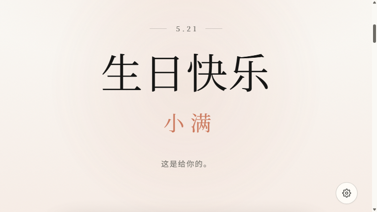
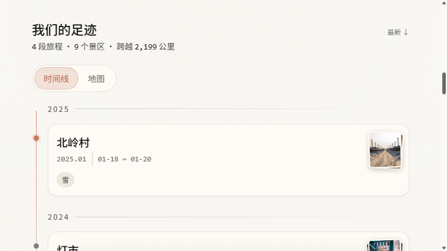
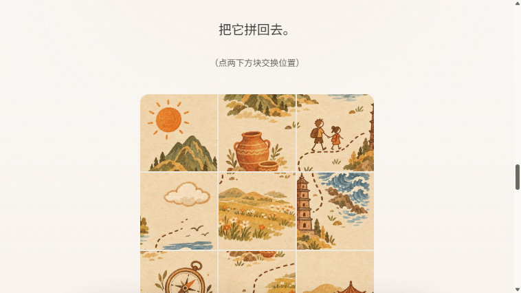
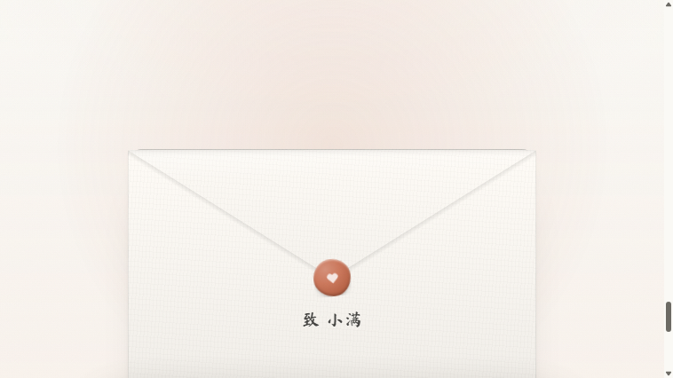

# 给最爱的人的生日网站

一个**零构建、可自托管**的「生日 + 旅行记录」网站模板。

平时它是一本可增删改的旅行手账：时间线 + 中国地图双视图、照片上传、按 EXIF 自动归点；
整站是一套九幕的庆祝叙事，**任何时候打开都是完整的**（模板默认如此，别人随手点开就能看完；
想改回「只在生日那几天切换」，把 `config.js` 的 `debug.forceBirthdayMode` 改成 false）——
解锁门 → 生日快乐 → 开场语 → 旅行足迹 → 刮刮卡 → 拼图 → 可吹灭的 3D 蛋糕 → 一封信 → 烟花祝福。

技术上刻意保持朴素：**原生 ES Modules + 少量 PHP + JSON 文件存储**。
没有 npm、没有打包、没有数据库、没有前端框架——改完文件用 FTP 传上去就生效。

---

## 界面一览

| 生日快乐 | 旅行足迹 |
|---|---|
|  |  |

| 刮刮卡 / 拼图 | 3D 蛋糕 | 一封信 · 烟花 |
|---|---|---|
|  |  |  |

## 功能一览

| 幕 | 内容 |
|---|---|
| 解锁门 | 一个只有 TA 答得上来的问题，答错 3 次自动放行 |
| 生日快乐 | 首屏大字 + 星空粒子 |
| 旅行足迹 | 时间线 ⇄ 中国地图（可缩放）双向联动，照片按 EXIF 时间/GPS 自动聚类到景区 |
| 刮刮卡 | Canvas 刮涂层，刮开 60% 自动全揭开 |
| 拼图 | 3×3 滑块拼图，拼好用的是你们的照片 |
| 蛋糕 | 手写 WebGL 2 的实时 3D 蛋糕，对麦克风吹气（或滑动屏幕）吹灭蜡烛 |
| 一封信 | 逐字浮现的信纸，支持 `~~划掉~~` 删除号，信封有拆信动画 |
| 烟花 | 祝福弹幕 + Canvas 烟花 |

其他：两套主题（日/夜，右下角切换）、背景音乐面板、管理口令（站内增删旅程）、
高德地理编码代理（可选，无 key 自动降级到内置 130 个景区库）。

## 快速开始

### 本地预览

```bash
cd code
python -m http.server 8080
# 打开 http://localhost:8080/?bday=1 看完整生日叙事（?bday=1 强制生日模式）
```

本地打开时自动使用内置假数据，不需要 PHP。改任何文件刷新即生效。

### 部署

任意支持 PHP 7.4+ 的虚拟主机都可以，免费方案推荐 InfinityFree：

1. 控制面板先申请 SSL 证书（Let's Encrypt），等签发完成
2. 把 `code/` **里面的内容**（不是外层文件夹）上传到 `htdocs/`
3. 复制 `code/api/config.example.php` 为 `code/api/config.php`，按文件内注释填好
4. 浏览器打开 `api/probe.php` 自检，全绿后**删掉 probe.php**
5. 想先看效果：`python tools/import-demo.py` 导入四段示例旅程与照片

详细步骤、HTTPS 与安全项见 `code/README.md`。

### 只想先看效果（没有 PHP 也能跑）

静态托管（GitHub Pages、对象存储、任何静态服务器）没有 PHP，接口必然 404。
这时把 `code/js/config.js` 里的 `api.fallbackToBundledData` 改成 `true`：

- 接口读不到 → 退回随包的 `data/trips.json`（示例旅程），页面照常能看完整个故事
- 顶部会提示「当前是随包的示例数据」，并藏掉「补上一段」（静态站点写不了数据）

⚠️ 自己有 PHP 后端就保持 `false`：后端出问题时宁可报错，
也不要让示例数据冒充真实记录。

### 导入示例内容

```bash
python tools/import-demo.py            # 首次部署、还没有数据时
```

云栖镇 / 屿城 / 灯市 / 北岭村四段示例旅程 + 照片（地名与日期均为虚构），把界面先撑起来，之后在站内随意增删。
照片来自 Pexels（可免费商用），授权与来源见 `demo/PHOTO-CREDITS.md`。

## 自定义（只需要改一个文件）

几乎所有内容都在 **`code/js/config.js`**，改完直接上传：

| 配置段 | 内容 |
|---|---|
| `site` | 标题、你的署名、TA 的名字或昵称（全站由它生成） |
| `birthday` | 生日月日与叙事展示窗口，每年自动触发 |
| `unlock` | 解锁门的问题与答案。示例仓库默认 `acceptAny: true` 放行任意输入，部署后改成 `false` 并换成只有 TA 答得出的答案 |
| `scratch` | 刮刮卡上写的那句承诺 |
| `puzzle` | 拼图图片（换成你们的合照，覆盖 `assets/puzzle.jpg` 即可） |
| `cake.model` | 自定义蛋糕 `.glb` 模型的地址；留 `null` 用内置程序化蛋糕 |
| `letter.text` | **那封信。示例信要换成你自己写的** |
| `fireworks.blessings` | 结尾的祝福弹幕 |

改了文案之后**必须重跑一次字体子集**（中文子集字体只包含用到的字，否则新字会退化成无衬线——
不报错、不显示方框，肉眼很难发现）：

```bash
pip install fonttools brotli -i https://pypi.org/simple
python tools/font-subset.py    # 需要 _fontsrc/ 里的源字体，脚本头部有下载命令
python tools/font-check.py     # 校验覆盖
```

改了名字还要重生成分享卡片：`python tools/make-og.py`（微信/QQ 发链接时的预览图）。

`code/index.html` 顶部的 `<title>` 与 `og:*` 是写死的（JS 改不到），改名时记得同步。

## 数据与隐私

- 旅行记录与照片存在**服务器本地**（`code/data/trips.json` + `code/uploads/`），不进仓库、不进任何第三方
- `code/api/config.php`（口令哈希、高德 key）已被 `.gitignore` 排除，仓库里只有模板
- 写接口有 CSRF token + 同源校验 + 频率限制；读取接口不需要登录
- 本仓库自带的信稿、名字、日期、地点全部是**示例内容**，发布前请换成自己的

## 技术要点（为什么长这样）

- **3D 蛋糕是手写 WebGL 2**（`code/js/lib/cake3d.js`）：整个场景只需要一个对象、
  一盏灯、一块柔光背景，引 three.js 反而让 JS 体积翻倍。WebGL 不可用/上下文丢失/
  减少动效模式都有降级路径，最低退回 CSS 平面蛋糕
- **吹蜡烛**用麦克风机：时域 RMS 判据 + 按秒累积的泄漏式计数，实测安静/说话/吹气
  三种电平分得开；8 秒吹不灭自动提示「滑一下也行」。getUserMedia 明确关掉
  AGC/降噪/回声消除——它们会把吹气压成说话电平
- **地图**用阿里 DataV.GeoAtlas 免费数据（`areas_v2`），免 key、符合官方标准画法，
  内置 v3 数据源自动降级
- **中文字体**自托管子集（衬线 Noto Serif SC + 手写马善政毛笔楷，均 SIL OFL），
  全站字体资产约 170KB
- **免费主机的坑**：InfinityFree 等免费主机对请求强制 JS 挑战，`fetch()` 拿到的
  是 HTML 挑战页——大文件（蛋糕 glb）请放对象存储并用绝对 URL，见 `config.js` 注释

## 目录结构

```
├─ code/                 全部站点代码，部署时上传的就是它
│  ├─ index.html         页面骨架
│  ├─ css/               主题、基础、各幕样式
│  ├─ js/
│  │  ├─ config.js       ★ 唯一需要你改的文件
│  │  ├─ lib/            数据层、主题、滚动、WebGL 蛋糕等
│  │  ├─ scenes/         九幕，每幕一个文件
│  │  ├─ components/     时间线、地图、录入抽屉、大图等
│  │  └─ data/spots-cn.js  内置景区库（约 130 个）
│  ├─ assets/            字体子集、favicon、og 图、拼图底图
│  ├─ api/               PHP 接口（读取/写入/上传/地理编码/自检）
│  ├─ data/              运行时生成：trips.json（不进仓库）
│  └─ uploads/           运行时生成：照片（不进仓库）
├─ demo/                 示例旅程与照片（tools/import-demo.py 导入）
├─ tools/                字体子集、og 卡片、照片批处理等脚本
└─ 3d/                   蛋糕模型的生成与转制脚本说明
```

## License

[MIT](LICENSE)。字体与示例照片各自另有授权，见 `demo/PHOTO-CREDITS.md` 与字体文件头部说明。

---

*做给一个人，也做给所有想认真记住「我们一起去过哪」的人。*
